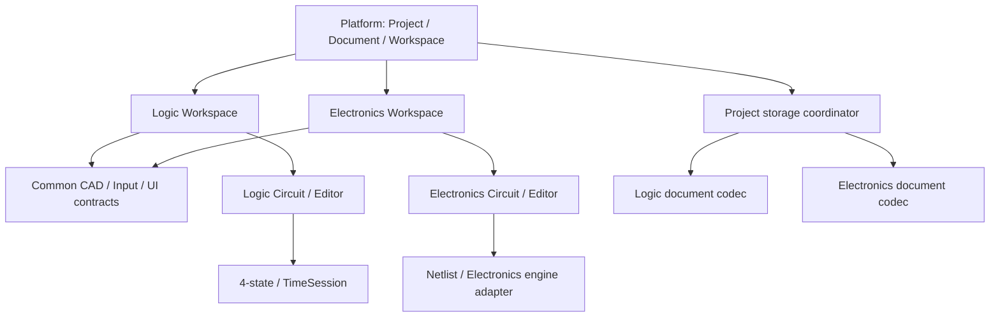

# Circlith 플랫폼 아키텍처 제안

작성: 2026-10-19 Asia/Seoul · PR-0 · 분석 기준 `f59efd2755e31be9b1bb4f70514cb20680421be7`.

**미래 설계 제안이며 구현된 기능이나 새 공식 명세가 아니다.** [Master Spec](../CIRCLITH_MASTER_SPEC.md)의 권위를 유지한다. Logic의 기존 규칙을 보완하는 경계 제안이고, 제품 범위 확대·문서 분리·저장 형식 확정은 후속 승인 및 명세 반영이 필요하다. 현재 앱은 단일 Logic 도면이며 Project/Workspace/Electronics는 미구현이다.

## 1. 선택: Alternative A, 하나의 src와 빌드

| 기준 | A: src/platform, common, logic, electronics | B: apps/web + packages/* |
|---|---|---|
| 현재 변경량 | 단계별 추출·기존 경로 호환 가능 | 진입점·import·테스트·배포 경로를 함께 변경 |
| TypeScript | 현재 Bundler 설정과 단일 tsconfig 유지 | package exports·참조·테스트별 해석 규칙 추가 |
| 빌드·테스트 비용 | 기존 npm/Vite/Vitest/Playwright 흐름 유지 | workspace 의존 순서·공통 패키지 테스트·CI 범위 관리 필요 |
| 경계 강제 | 공개 진입점과 import 검토 필요 | exports로 강제하기 쉬우나 소스 직접 참조 시 무력화 |
| 두 개발자의 병렬 작업 | Logic/Electronics 소유 파일과 공통 계약을 명시하면 가능 | 소유권은 명확하나 계약 충돌은 여전히 발생 |
| 성능·번들 | workspace 진입점의 동적 import로 분리 가능 | 패키지 분리 자체로 번들 크기가 줄지는 않음 |
| 향후 패키지화 | 의존 방향이 정리된 후 파일 경계대로 승격 | 지금부터 별도 배포·버전 관리가 필요할 때 유리 |
| 장기 유지 | 현재 단일 앱·61개 src 파일 규모에 맞음 | 독립 소비자·여러 앱이 생기면 재검토 |

추천은 A이다. PR-0에서는 디렉터리를 만들거나 소스를 옮기지 않는다. npm workspaces·새 프레임워크·상태관리 라이브러리는 도입하지 않는다. 아래는 승인 후 단계적으로 도달할 목표다.

```text
src/
  main.tsx
  platform/             # project/document 수명, workspace shell, 저장 조정
  common/
    cad/                # 점·경로·viewport 수학, 선택/명령의 작은 계약
    input/              # 입력 해석 기구; 작업별 명령은 각 workspace가 등록
    ui/                 # 패널 프레임, theme, 진단 표시
  logic/                # 현재 Circuit, Editor, renderer, simulator, time session
  electronics/          # 별도 circuit/editor/netlist/engine adapter
```

## 2. 의존 방향과 데이터 흐름



`common`에서 platform/logic/electronics를 import하지 않는다. Logic과 Electronics 사이에는 직접 import가 없다. Platform은 workspace 공개 factory와 문서 codec만 사용하며 circuit internals를 해석하지 않는다. 저장 codec은 도메인이 제공하고 일괄 저장·복구·오류 UI는 platform이 조정한다. 필요해질 때만 Worker 경계를 추가하고, 현재 Logic 실행 위치를 미리 바꾸지 않는다.

사용자 입력 → 활성 문서의 resolver/dispatcher → 도메인 Editor의 초안 → 검증 → 단일 commit → 해당 문서의 변경 알림 → 도메인 renderer 및 simulation invalidation 순서다. Viewport와 선택만 바꾼 경우 circuit revision은 바꾸지 않는다. 진단 클릭은 `{workspace, documentId, objectIds}`로 해당 문서의 locate 함수를 부른다.

Workspace는 Logic/Electronics, 내부 작업은 편집/시뮬레이션/분석, Document는 개별 도면이다. 현재 Vite의 `editor`/`simulation` **빌드 모드**는 Workspace 개념이 아니다. 탭 전환으로 URL 새로고침·별도 HTML·별도 공개 앱을 만들지 않는다.

## 3. 실제 코드에서 찾은 경계

`src/ui/App.tsx`는 1,506줄이다. Editor 생성과 강제 render, inputValues·컴파일, useTimeSession, pointer/hover/드래그 refs, DOM hit 판정, resolver/dispatcher 핸들러, localStorage, 패널·모달·SVG 표시를 함께 소유한다. `projectName`은 문자열이고 `dirty`는 history 길이·이름으로 추정할 뿐 Project 저장 모델이 아니다.

분리 순서는 (1) 문서별 runtime 소유자, (2) 기존 App 전체를 LogicWorkspace로 감싸기, (3) 입력·gesture 수명과 simulation controller를 Logic 내부 모듈로 추출, (4) 입증된 순수 함수만 common으로 추출이다. JSX 패널 분할부터 시작해도 전역 Editor·timer를 그대로 두면 문서 전환 문제는 해결되지 않는다.

| 현재 기능/위치 | 재사용 판단 | 필요한 경계와 위험 |
|---|---|---|
| Viewport, Pan/Zoom: geometry/view.ts, App | 수학 부분 공유 | zoomView/wheelZoomFactor는 분리 가능. fitView는 gate 크기와 Circuit 의존 → bounds 입력 필요. 10–800%, 커서 고정 유지 |
| Selection: geometry.ts, selection-hit.ts, Editor | 집합·사각형/선분 판정만 공유 | Logic pin/몸체/배선 hit와 선택 가지치기는 Logic. 좌→우 포함·우→좌 교차·Shift 유지 |
| Keyboard: input/types, resolver, keyboardAdapter | 기구 공유 | command registry·context·availability는 주입. IME/텍스트/모달/예약키 정책 유지 |
| Command Registry/Dispatcher | 작은 dispatch 계약 공유 | dispatcher는 전역 registry를 import. command ID·프로필 저장 키를 함부로 바꾸지 않음 |
| Undo/Redo: Editor.Command | 인터페이스만 공유 | before/after가 Circuit인 snapshot history는 Logic 전용. 도메인별 history 소유, 초안 Undo 2단계와 실패 불변성 유지 |
| Panel Layout: WorkspaceHeader, InspectorPanel, CSS | 프레임·접힘 UI 공유 | 현재 props는 Circuit·Logic UI에 결합. 진단/속성 슬롯 분리, 반응형·focus 회귀 위험 |
| Theme: style.css, workspace.css | 향후 토큰·기본 프레임 공유 | 완성된 theme 시스템은 없음. 전역 selector 누출 방지, 별도 다크모드 구현을 이번 단계로 오해하지 않음 |
| Project/Document Management | 신규 platform 책임 | 현재 다중 문서 없음. storage 브랜치의 단일 도면 기능을 평가·통합 후 확대 |
| File Import/Export | I/O 조정만 공유 | main에 circuit 파일 저장 없음. 도메인별 validator/codec, 취소·실패 시 기존 문서 보존 |
| Diagnostics Presentation | 공통 severity·locate envelope 공유 | Logic DiagnosticCode/0·1·X·Z와 SPICE 수렴/단위 오류는 각각 유지 |

현재 Editor는 `Kind`, `Circuit`, `ConnectionTarget`, `planRoute`, `connectTargets`, `deleteObjects`, `updateComponentProperties`에 직접 의존한다. Electronics는 **같은 Editor 클래스를 직접 재사용하지 않는다.** 기존 Logic Editor를 유지하고 작은 command/viewport/selection 계약을 공유한다. 범용 `Circuit<T>` 또는 공통 Net으로 바꾸는 설계는 채택하지 않는다.

Geometry 디렉터리도 전부 공통이 아니다. `path.ts`의 점·경로 연산은 좋은 후보지만 Point를 model/circuit에서 가져온다. `geometry.ts`는 Logic pin 좌표·게이트 높이·연결 유지 transform, `routing.ts`는 Logic obstacle 및 설정 키, `wire-edit.ts`의 replaceWirePath는 endpoint 검증에 의존한다. `wire-bridges`/`wire-overlaps`는 표시 기능이어도 net ID와 junction을 사용한다. adapter로 선분/bounds를 제공할 필요가 입증될 때만 추출한다. 화면상 교차와 전기적 접속을 같은 이벤트로 취급하지 않는다.

## 4. 문서와 저장 모델 예시

아래 TypeScript는 **문서용 예시**다. 프로젝트 형식은 미확정이며 기존 storage 브랜치의 `circlith.circuit` v1과 다르다. `ElectronicsCircuit` 등은 향후 해당 도메인이 정의한다. 이를 src에 복사해 선행 구현하지 않는다.

```ts
type WorkspaceKind = 'logic' | 'electronics';
type ProjectId = string;
type DocumentId = string;
type ISODate = string;
type ViewState = { x: number; y: number; zoom: number };
type DocumentBase = { id: DocumentId; name: string; revision: number };
type LogicDocument = DocumentBase & {
  workspace: 'logic'; modelVersion: 1; circuit: LogicCircuit; // 기존 Circuit 유지
};
type ElectronicsDocument = DocumentBase & {
  workspace: 'electronics'; modelVersion: 1; circuit: ElectronicsCircuit;
};
type CircuitDocument = LogicDocument | ElectronicsDocument;

interface ProjectSettings {
  // 프로젝트 의미 설정만. 입력 프로필·theme는 기존 사용자 설정과 분리
  description?: string;
}
interface CirclithProject {
  format: 'circlith.project';
  version: 1; // 제안값; 발행 전에 호환 정책 확정
  id: ProjectId;
  name: string;
  documents: CircuitDocument[];
  settings: ProjectSettings;
  metadata: {
    createdAt: ISODate;
    modifiedAt: ISODate;
    savedAt?: ISODate;
    revision: number;
  };
  ui?: { // 선택적 편의 정보; 실패해도 도면을 손상시키지 않음
    activeWorkspace: WorkspaceKind;
    lastActiveDocument: Partial<Record<WorkspaceKind, DocumentId>>;
    views: Record<DocumentId, ViewState>;
  };
}
interface RecoveryEnvelope {
  format: 'circlith.project-recovery';
  version: 1;
  projectId: ProjectId;
  tabId: string;
  checkpointId: string;
  recoveredFromSavedRevision?: number;
  writtenAt: ISODate;
  project: CirclithProject;
}

// 아래는 메모리 전용. 프로젝트 JSON과 별도로 관리한다.
interface RuntimeBase {
  projectId: ProjectId;
  documentId: DocumentId;
  view: ViewState;
  inspector: { open: boolean; selectedTab: string };
}
type DocumentRuntime =
  | (RuntimeBase & { workspace: 'logic'; editor: LogicEditor;
      simulation: LogicSimulationController })
  | (RuntimeBase & { workspace: 'electronics'; editor: ElectronicsEditor;
      simulation: ElectronicsSimulationController });
interface WorkspaceRuntime {
  kind: WorkspaceKind;
  lastActiveDocument?: DocumentId;
  inspector: { open: boolean; selectedTab: string };
}
```

Project ID와 Document ID는 이름과 분리하고 프로젝트 안에서 유일해야 한다. 문서 내부 component/pin/net ID는 그대로 보존한다. runtime key는 projectId+documentId로 만들며 workspace와 문서 discriminator를 검증한다. 문서 revision은 확정 편집마다 갱신하되 선택/보기는 제외한다. dirty는 저장된 fingerprint/revision과 비교하며 history 길이를 파일 저장 여부로 사용하지 않는다.

파일에는 설계 circuit, Clock 설정, DFF 초기 Q를 보존한다. history/future, 미확정 draft, 현재 Input 자극, live Q·시간·이벤트 큐·파형, DOM refs, 파일 handle은 넣지 않는다. 복구본은 마지막 확정 설계이며 파일 저장 완료로 표시하지 않는다. 복구 메타데이터는 별도 envelope로 보관하고 quota·충돌·손상 시 원본을 먼저 보존한다.

알 수 없는 workspace/modelVersion을 읽으면 조용히 삭제하거나 Logic으로 변환하지 않는다. 초기 버전은 전체 open을 비파괴적으로 거부하고 원본 파일을 유지하는 정책을 권장한다. 부분 읽기·불투명 payload 왕복 보존은 별도 결정이다. JSON의 중복 ID·비정상 수치·소유권·상한을 도메인별 검증하고 전체 성공 뒤 한 번에 문서를 교체한다.

기존 v1 회로 파일은 프로젝트의 Logic 문서 하나로 감싸는 import adapter를 둔다. 기존 v1 export를 유지할지, Clock/DFF를 포함한 새 circuit 버전이 필요한지 storage 통합 전에 결정한다. 현재 storage codec은 구 kind 목록과 알려진 필드만 복사하는 sanitizer를 사용한다. kind 추가만으로 clock/dff 속성 보존이 해결되지 않는다.

## 5. Workspace 전환 트랜잭션

1. source 문서와 요청 대상 ID를 캡처한다. source timer를 pause하고 비동기 결과의 세대 토큰을 무효화한다.
2. App의 rollback과 동일한 수명 처리를 제공한다. 미완료 배선/이동/배치/선분 편집/선택박스는 취소, pan은 시작 viewport로 복원, pointer capture·Space·hover·resolver sequence·메뉴를 해제한다. 취소된 preview는 history/recovery에 들어가지 않는다.
3. source의 확정 circuit, history/future, selection, view, inspector, simulation session을 runtime map에 남긴다. document를 unmount해도 소유 runtime은 버리지 않는다.
4. 대상 workspace의 lastActiveDocument를 확인한다. 없거나 삭제됐으면 같은 workspace의 첫 문서 또는 빈 상태를 표시한다. 다른 workspace 문서를 fallback으로 열지 않는다.
5. target runtime을 연결하고 focus를 canvas 또는 빈 상태로 보낸다. 기존 문서로 돌아오면 viewport와 Undo/Redo 및 일시정지된 시간/Q/파형을 되살린다. 자동 Run 재개는 하지 않는다.

설정/속성 모달이나 저장 확인 중 전환은 완료/취소를 먼저 요구한다. 조용히 Apply하거나 버리지 않는다. 실제 문서 닫기/교체의 save/discard/cancel은 workspace 전환과 별도다. 비활성 문서는 단축키와 wheel 이벤트를 받지 않는다. 기존 `visibilitychange` 가드만으로 SPA 내부 탭 전환을 감지할 수 없으므로 명시적인 deactivate가 필요하다.

현재 `useTimeSession`은 circuit 객체/활성 조건 변경 시 세션을 다시 만들고 mount 내부 state로 Run을 관리한다. 단순 조건부 렌더링은 session을 잃을 수 있다. 소유권 이전 때 같은 circuit의 세션을 유지하고 확정 편집·Undo/Redo에서는 현재처럼 pause 후 t=0으로 초기화한다.

## 6. 시뮬레이터 경계

Logic의 `logic.ts`, `simulator.ts`, `time-session.ts`는 전용이다. 4상태 구동 해석, SCC 진단, 0.01 µs 정수 시간, 동시 Clock/DFF 처리, 64 delta round·2,048 timestamp·32 watch·512 sample 한도를 유지한다. Electronics 수치 해석의 시간 step·수렴·단위와 공통 상태 객체를 만들지 않는다.

Electronics는 별도 circuit → netlist compiler → 엔진 adapter → 결과 모델을 갖는다. SPICE 공급자·WASM/Worker·라이선스·오프라인 자산·해석 범위는 PR-7 전 결정하며 PR-0에서 엔진을 선택하거나 구현하지 않는다. 디지털 소자 지원과 아날로그 해석의 단계도 명시적으로 나눈다.

향후 mixed-signal은 project 내 명시적 bridge 문서/계약, 단위, 임계값·히스테리시스, 양방향 구동 정책, 시간 동기화, 실패 전파를 별도 RFC로 설계한다. 현재 두 엔진이 서로의 net이나 상태를 직접 참조하는 확장점은 만들지 않는다.

## 7. 승인 및 구현 전 결정

Master Spec에 플랫폼 범위를 어떻게 추가할지, 저장·클립보드 이력 통합 순서, 파일 버전·unknown domain 처리, source 파일 이동별 소유권을 확정한다. 문서 분리와 모노레포 전환은 별도 승인 대상이다. [Migration Plan](MIGRATION_PLAN.md)과 [Handoff](IMPLEMENTATION_HANDOFF.md)의 검증 gate를 통과한 뒤 구현한다.
